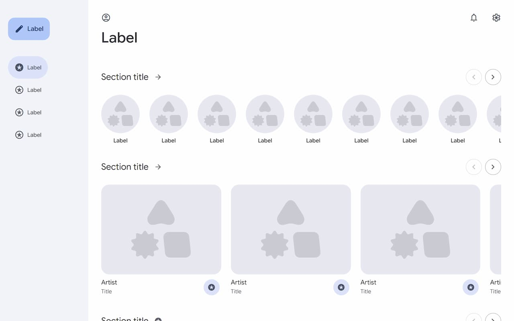
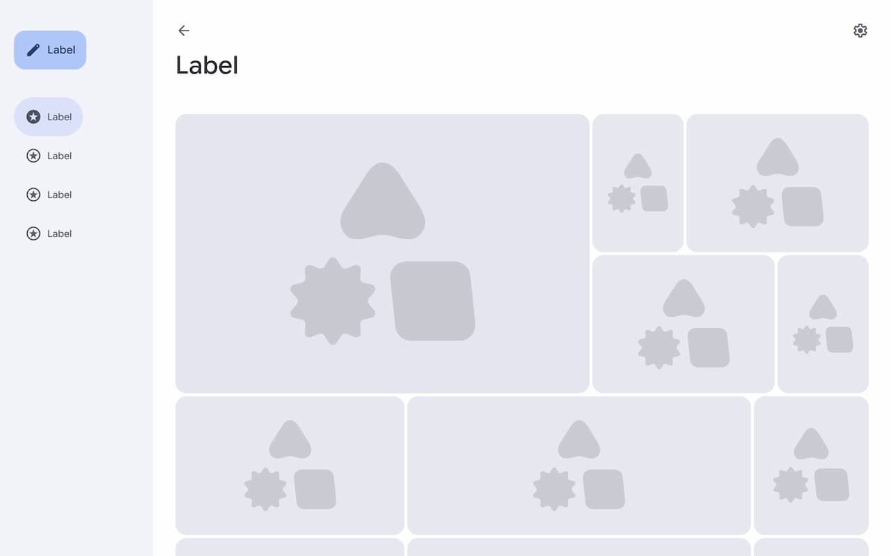
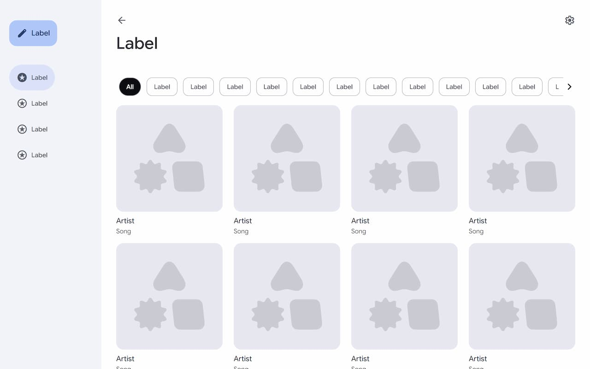
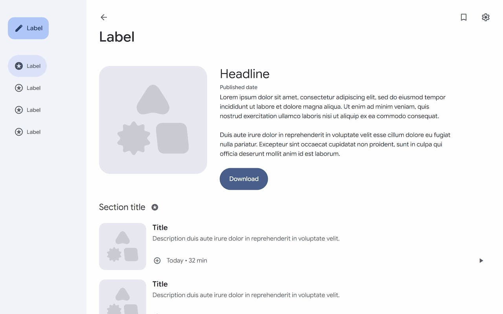
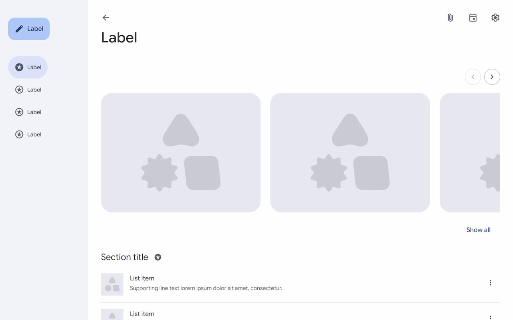
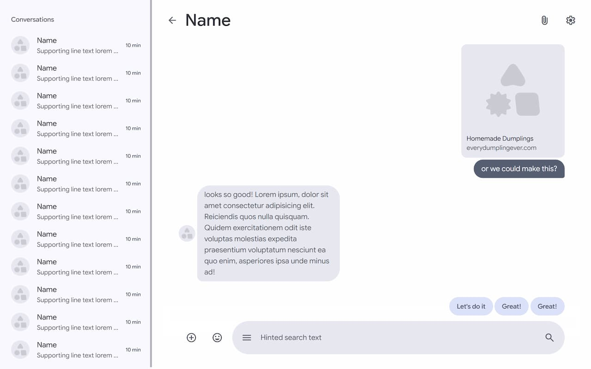
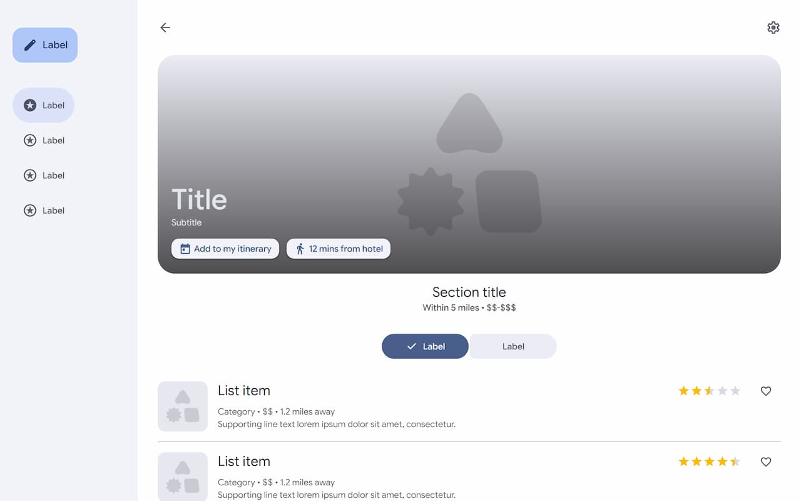

# Layout examples

Example layouts are meant to be starting points, not final destinations. Modify them, experiment, and add your own touch to create an interface that feels truly yours.

| Starter | Use it for |
| --- | --- |
| [Home feed](home-web.html) | A content-rich landing experience with featured and supporting sections. |
| [Gallery](gallery-web.html) | Image-led browsing with responsive collections and alternate content views. |
| [Library](library-web.html) | Searchable or filterable collections of saved, owned, or cataloged items. |
| [Detailed view](detailed-view-web.html) | A focused item, article, or product view with actions and related content. |
| [Upcoming content](upcoming-web.html) | Scheduled releases, events, episodes, or other time-oriented content. |
| [Messaging](messaging-web.html) | Conversation navigation, message history, composing, and suggested replies. |
| [Reviews and ratings](review-web.html) | Rating summaries, featured feedback, and review lists. |

Use the library's structure as provided, or reorganize the markup and styles to fit your needs, framework, and project conventions.

## Using a layout

Choose the starter closest to your product. Click its preview or use the download link to get the complete single-file HTML starter.

### Home feed

<a href="https://raw.githubusercontent.com/mobalti/web-expressive/main/examples/layouts/home-web.html">
  <picture>
    <source media="(max-width: 600px)" srcset="previews/home-small-screen.jpg">
    
  </picture>
</a>

[Download HTML](https://raw.githubusercontent.com/mobalti/web-expressive/main/examples/layouts/home-web.html)

### Gallery

<a href="https://raw.githubusercontent.com/mobalti/web-expressive/main/examples/layouts/gallery-web.html">
  <picture>
    <source media="(max-width: 600px)" srcset="previews/gallery-small-screen.jpg">
    
  </picture>
</a>

[Download HTML](https://raw.githubusercontent.com/mobalti/web-expressive/main/examples/layouts/gallery-web.html)

### Library

<a href="https://raw.githubusercontent.com/mobalti/web-expressive/main/examples/layouts/library-web.html">
  <picture>
    <source media="(max-width: 600px)" srcset="previews/library-small-screen.jpg">
    
  </picture>
</a>

[Download HTML](https://raw.githubusercontent.com/mobalti/web-expressive/main/examples/layouts/library-web.html)

### Detailed view

<a href="https://raw.githubusercontent.com/mobalti/web-expressive/main/examples/layouts/detailed-view-web.html">
  <picture>
    <source media="(max-width: 600px)" srcset="previews/detailed-view-small-screen.jpg">
    
  </picture>
</a>

[Download HTML](https://raw.githubusercontent.com/mobalti/web-expressive/main/examples/layouts/detailed-view-web.html)

### Upcoming content

<a href="https://raw.githubusercontent.com/mobalti/web-expressive/main/examples/layouts/upcoming-web.html">
  <picture>
    <source media="(max-width: 600px)" srcset="previews/upcoming-small-screen.jpg">
    
  </picture>
</a>

[Download HTML](https://raw.githubusercontent.com/mobalti/web-expressive/main/examples/layouts/upcoming-web.html)

### Messaging

<a href="https://raw.githubusercontent.com/mobalti/web-expressive/main/examples/layouts/messaging-web.html">
  <picture>
    <source media="(max-width: 600px)" srcset="previews/messaging-small-screen.jpg">
    
  </picture>
</a>

[Download HTML](https://raw.githubusercontent.com/mobalti/web-expressive/main/examples/layouts/messaging-web.html)

### Reviews and ratings

<a href="https://raw.githubusercontent.com/mobalti/web-expressive/main/examples/layouts/review-web.html">
  <picture>
    <source media="(max-width: 600px)" srcset="previews/review-small-screen.jpg">
    
  </picture>
</a>

[Download HTML](https://raw.githubusercontent.com/mobalti/web-expressive/main/examples/layouts/review-web.html)

Each layout stays in one HTML file so it can be opened, inspected, adapted, or separated into project files immediately.

**Using a layout with an AI agent:** Give the agent the downloaded HTML file and, when useful, a screenshot. Describe the product, content, and target environment. Each layout includes direct references to the Web Expressive setup guide, imports, component API, design tokens, schemes, and other examples.
